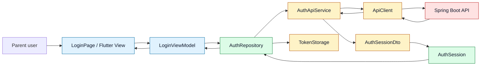
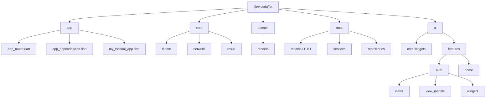
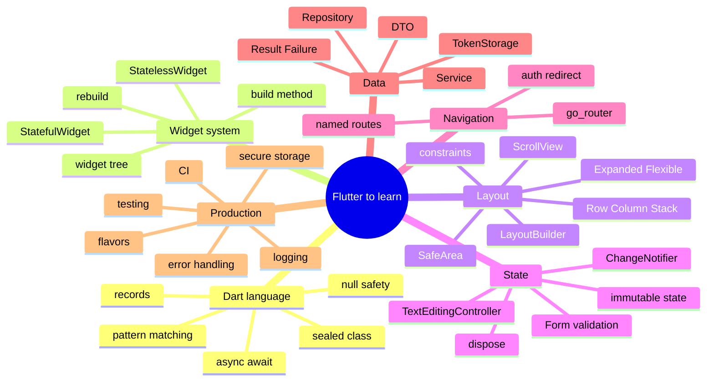
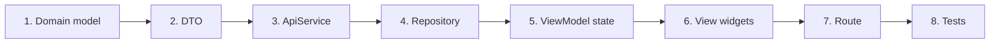
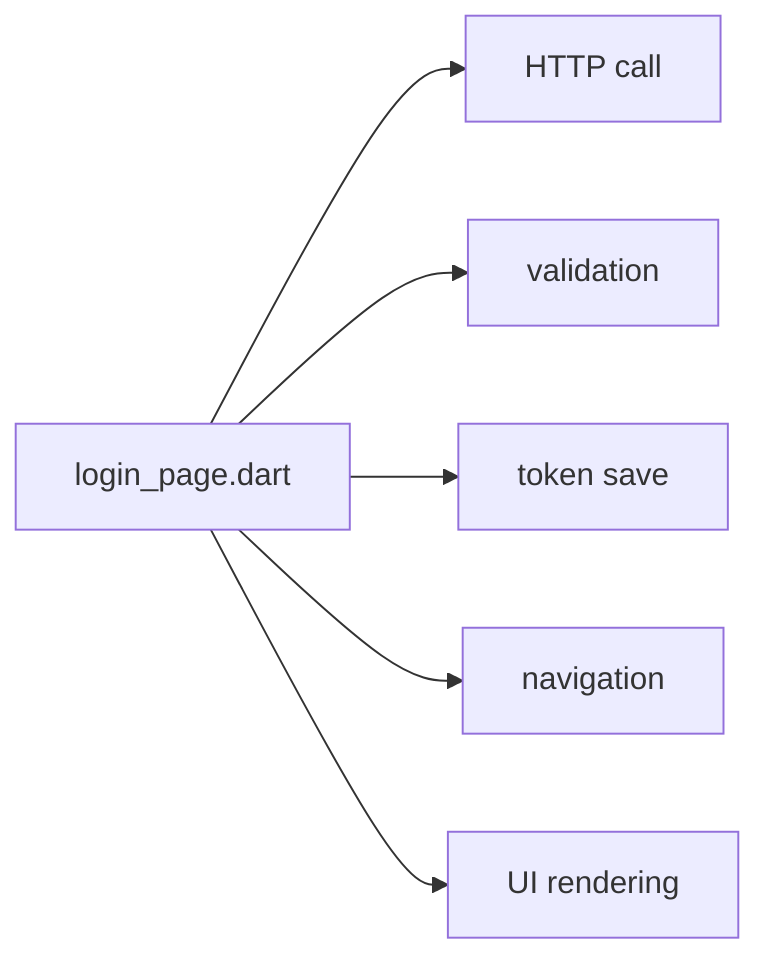
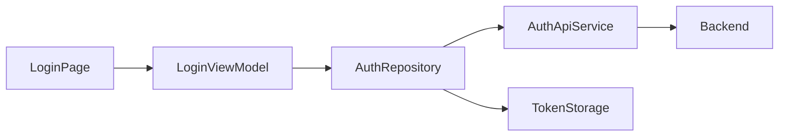

# Flutter Architecture Visualization

This note explains the current Flutter structure in this project with diagrams.
User-facing app text stays Vietnamese, but screen and file names stay English.

## 1. Runtime Flow



Read it like this:

- `View` renders widgets and forwards user actions.
- `ViewModel` owns screen state, validation, and commands.
- `Repository` is the app-facing data boundary.
- `Service` talks to one external thing: HTTP, storage, platform API.
- `DTO` is backend-shaped data.
- `Domain` is app-shaped data.

## 2. Project Structure



## 3. Java / React / Flutter Mapping

| Concept | Java / Spring thinking | React thinking | Flutter thinking |
|---|---|---|---|
| App entry | `main()` / Spring Boot app | `main.jsx`, `App` | `main.dart`, `runApp()` |
| Dependency setup | Spring beans / configuration | providers, context, hooks | `AppDependencies`, constructor injection |
| Route setup | controller mappings | React Router | `go_router` |
| Screen | controller + template idea, loosely | page component | `View` / `Page` widget |
| Screen state | service state / DTO state | `useState`, Zustand, React Query | `ChangeNotifier` ViewModel |
| API boundary | service/client bean | API client module | `ApiService` + `ApiClient` |
| Data boundary | service/repository | query function / repository module | `Repository` |
| JSON model | request/response DTO | API response type | DTO class |
| Business model | domain/entity model | app type/model | domain model |
| UI rebuild | not a direct Java concept | component rerender | widget rebuild |
| Cleanup | `close()`, lifecycle callbacks | `useEffect` cleanup | `dispose()` |

## 4. Mental Model



## 5. Feature Build Sequence

Use this sequence for every new feature such as Schedule, Semester Grades, Events, Applications, or Clubs.



Example for `Schedule`:

```text
domain/models/schedule_item.dart
data/models/schedule_item_dto.dart
data/services/schedule_api_service.dart
data/repositories/schedule_repository.dart
ui/features/schedule/view_models/schedule_view_model.dart
ui/features/schedule/views/schedule_page.dart
ui/features/schedule/widgets/schedule_list_tile.dart
app/app_router.dart
```

## 6. Why This Is Not Just Folder Decoration

Bad beginner flow:



Production-oriented flow:



The second flow is easier to test, easier to replace, and easier to debug.

## 7. What To Learn Next In This Project

Recommended order:

1. `main.dart` and `runApp`.
2. `MyFSchoolApp` and `MaterialApp.router`.
3. `go_router` in `app_router.dart`.
4. `AppDependencies` as simple dependency injection.
5. `LoginPage`: `StatefulWidget`, `initState`, `dispose`.
6. `LoginViewModel`: `ChangeNotifier`, immutable state, validators.
7. `LoginForm`: `Form`, `TextFormField`, controllers.
8. `AuthRepository`: DTO to domain mapping and token storage.
9. `ApiClient`: async HTTP and error handling.
10. Tests for ViewModel and Repository.

