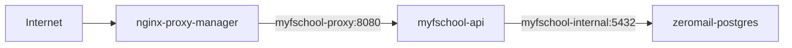

# Backend VPS Deployment Design

## Goal

Deploy the Spring Boot backend at `https://myfschool.kl3in.tech` on the
existing ZeroMail VPS without exposing PostgreSQL or the application container
directly to the public network.

## Runtime

- Repository root: `/apps/myfschool`.
- Reverse proxy and TLS: the existing Nginx Proxy Manager container.
- API: one non-root Spring Boot container with a 1 GiB memory limit.
- Database: dedicated `myfschoolse1913` database and `myfschool` role in the
  existing PostgreSQL 18 + pgvector container.
- Secrets: server-local `.env` and PEM files under `secrets/`; never committed.
- JWT: persistent RSA key pair so access tokens survive application restarts.

## Seed Policy

Run the school/user fixture once for the initial demo database, then set
`SEED_DEMO_USER=false` before the steady-state restart. Knowledge fixture
ingestion has its own `SEED_DEMO_KNOWLEDGE` flag because it requires an OpenAI
embedding key and must not block the core school demo data.

## Recovery

Keep the previous image id and a PostgreSQL custom-format backup before future
deployments. A deployment is accepted only after container health, public HTTPS,
authentication, and one role-scoped API smoke test succeed.
